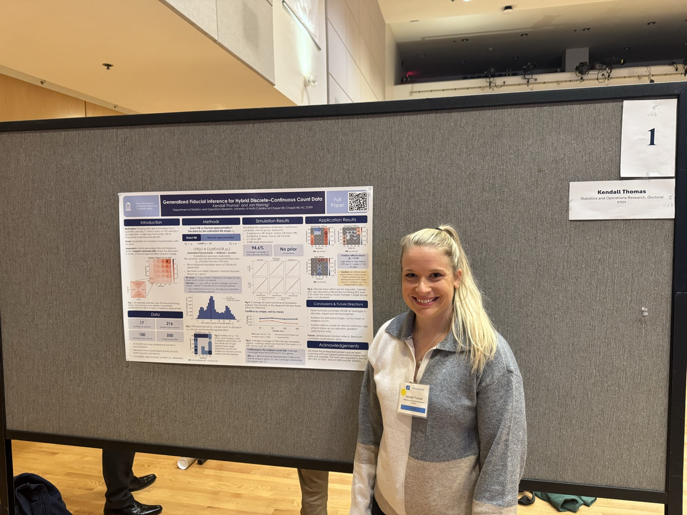

**"Generalized Fiducial Inference for Hybrid Discrete–Continuous Count Data"** — *Graduate Research Symposium*, October 2026, University of North Carolina at Chapel Hill

{fig-alt="Kendall Thomas standing next to her poster at the UNC Graduate Research Symposium" style="border-radius:4px; width:100%; max-width:600px;"}

<iframe src="images/hgfi_poster.pdf" class="pdf-viewer">

Your browser can't preview PDFs. <a href="images/hgfi_poster.pdf">Click here to download instead.</a>

</iframe>

[⬇ Download PDF](images/hgfi_poster.pdf)
