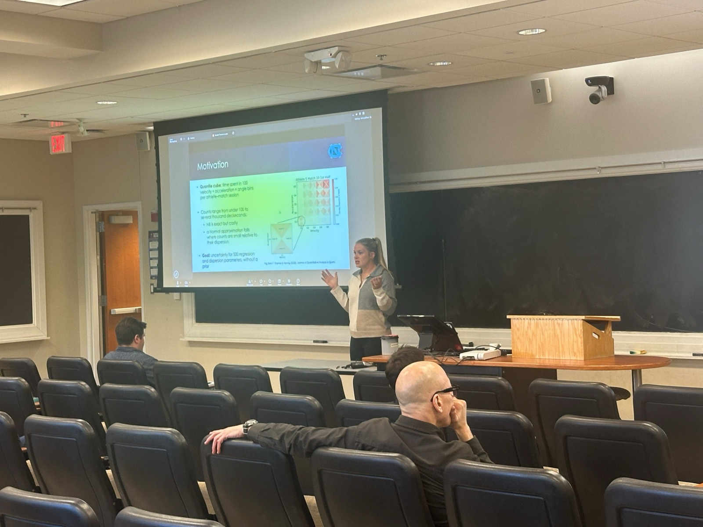

**"Generalized Fiducial Inference for Hybrid Discrete–Continuous Count Data"** — Featured Research Talk, *STOR Graduate Student Showcase*, October 19, 2026, University of North Carolina at Chapel Hill

{.d-block .mx-auto fig-alt="Kendall Thomas presenting her research talk to an audience in a UNC classroom" style="border-radius:4px; width:100%; max-width:600px;"}

<iframe src="images/research_week_hgfi_2026.pdf" class="pdf-viewer">

Your browser can't preview PDFs. <a href="images/research_week_hgfi_2026.pdf">Click here to download instead.</a>

</iframe>

[⬇ Download Slides](images/research_week_hgfi_2026.pdf)
